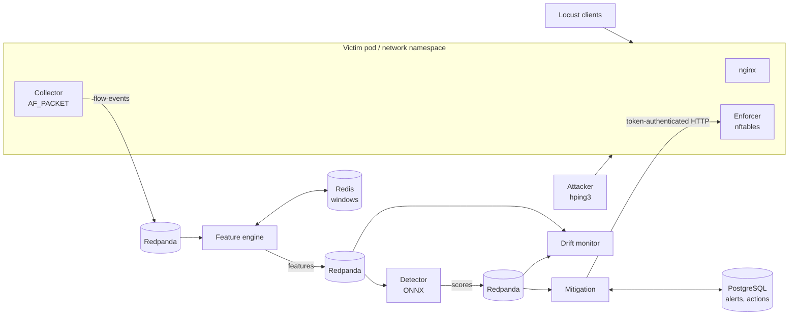

# Gatekeeper

Real-time DDoS detection and automated mitigation. Gatekeeper watches traffic to a service,
scores every source each second, and rate-limits, then blocks, flooding sources in the
victim's own nftables, while legitimate clients keep working.

The detector is one swappable part. The project is the system around it: a streaming pipeline,
sliding-window features with exactly-once counting, ONNX model serving, idempotent mitigation,
monitoring with drift detection, and a Kubernetes deployment tested under failure.

```
make venv
make demo
```

```
[  0.9s] pipeline ready: normal clients are browsing the victim and being scored
[  1.2s] attacker 172.30.0.200 starts a SYN flood for 30 s
[  5.3s] detected: attacker rate-limited 4.1 s into the attack
[ 10.1s] still attacking: blocked 8.9 s into the attack
[ 32.3s] flood over: nftables dropped 14,337 attack packets
[ 32.5s] normal traffic during the attack: 762 requests, 0 failed
PASS: attacker blocked after 8.9 s; normal clients unaffected
```

Requirements: Docker (with Compose), Python 3.11+, about 4 GB of memory for Docker. All
attack traffic stays on an isolated Docker network, aimed at the project's own containers.
Grafana is at http://localhost:3000 while the stack runs; `make down` stops it.

## Architecture



- **Collector** captures packets in the victim's network namespace and publishes one flow event
  per packet to Kafka, keyed by source IP.
- **Feature engine** keeps per-second buckets in Redis and emits 10 s sliding-window features for
  every active source each second: packet and byte rate, SYN/ACK ratio, and destination-side
  source count and entropies. Counting is exactly-once: a batch's counters and its Kafka offsets
  are written in one Redis transaction, so replays after a crash are skipped. Replicas hold no
  state of their own and scale as consumer-group members.
- **Detector** implements `score(features) -> float`: a threshold baseline, or XGBoost and an
  autoencoder served with ONNX Runtime, swapped by config only.
- **Mitigation** rate-limits a source after 3 consecutive flagged windows and blocks it after 5
  more, honouring an allowlist. Rules expire on their own (nftables timeout sets), every
  decision is logged in PostgreSQL, and replayed scores never create duplicate actions.
- **Drift monitor** compares live normal traffic with the training data (one-sided PSI) and
  alerts when models may be going stale.

Every service exports Prometheus metrics; Grafana and the alert rules are provisioned from
`infra/monitoring/`.

## Results

**Detectors** (`docs/results.md`; recorded sessions, split by session, flagged at score ≥ 0.5):

| | Threshold | XGBoost | Autoencoder |
|---|---|---|---|
| False positives, normal traffic | 0.0% | 0.0% | 0.1% |
| False positives, flash crowd (never trained on) | 73.6% | 0.0% | 100.0% |
| Detection, seen attacks (SYN/HTTP/mixed) | 100% | 100% | 100% |
| Detection, unseen attack type (UDP) | 100% | 0% | 100% |
| CPU per window | 0.5 µs | 6.2 µs | 9.1 µs |

No detector wins everywhere: the supervised model ignores flash crowds but misses an attack type
it never saw; the threshold and autoencoder catch every attack but flag flash crowds. The default
is the threshold detector, because missing a new attack type is the worse failure here.

**Scaling** (`docs/scaling.md`; kind, one 8-vCPU node, 40,000 events/s from 1,600 clients):
1 replica can't keep up (CPU-bound), 2 is break-even, and 4 replicas keep up with every source
scored each second at p99 detection latency under 1 s. The first bottleneck is the feature
engine's per-event Python work, not Kafka or Redis. KEDA scales on consumer-group lag.

**SLO** (`docs/slo.md`): an attacking source is rate-limited within **5 s** while the system is
healthy, and within **20 s** while one component fails. Chaos tests kill feature-engine and
detector pods, restart Redis and restart one of three Redpanda brokers; worst measured 18.2 s.

## Running it

| Command | What it does |
|---|---|
| `make venv` | Python environment and the pre-commit hook |
| `make up` / `make down` | Start / stop the Compose stack |
| `make demo` | Start the stack, flood the victim, narrate the mitigation |
| `make ci` | Lint (ruff, strict mypy), unit tests (100% coverage), image build |
| `make gate N=<phase>` | Phase acceptance tests (`tests/gates/`, phases 0-5c) |
| `make dataset` / `train` / `evaluate` | Regenerate the dataset, models and `docs/results.md` |
| `make k8s-up` / `k8s-down` | The same system on kind with Calico and KEDA |
| `make load-test` | The 1/2/4-replica table in `docs/scaling.md` |

The detector is chosen with `DETECTOR=threshold|xgboost|autoencoder`. Training needs the `[ml]`
extra (`pip install -e '.[ml]'`); trained models are committed in `models/`.

## Limitations

- **Simulated traffic.** Normal clients are Locust and attacks are hping3, in a lab network.
  Real traffic is burstier and more varied.
- **Generator overfitting.** The dataset comes from this project's own traffic generators, so the
  learned models may partly learn the generators' quirks. Holding out attack types and flash
  crowds exposes some of this, not all of it.
- **Local scale.** All numbers come from one laptop: one kind node shared by brokers, state
  stores, services and load generators. They show how the system scales and fails, not
  internet-scale capacity. The 5 s healthy objective has little slack on that saturated node.
- **Flash crowds.** The default detector flags most legitimate traffic surges, so a sudden crowd
  of real users would be rate-limited until it subsides (rules expire after `RULE_TTL_S`).
  XGBoost avoids that but misses unseen attack types; combining them is the obvious next step.
- **Per-source mitigation.** Volumetric floods only. Blocking by source IP does little against a
  heavily distributed or spoofed-source flood, and one very loud source loads a single partition
  (`docs/slo.md`).

## More

- `docs/PROPOSAL_AND_PLAN.md`: the original proposal; `PLAN.md`: phases and their gates.
- `NOTES.md`: what broke along the way and what was measured.
